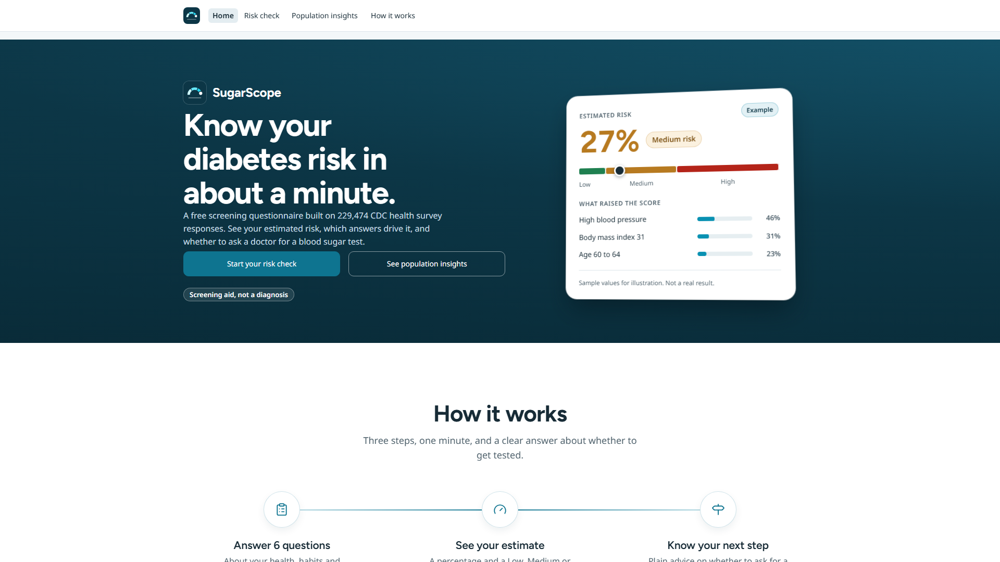
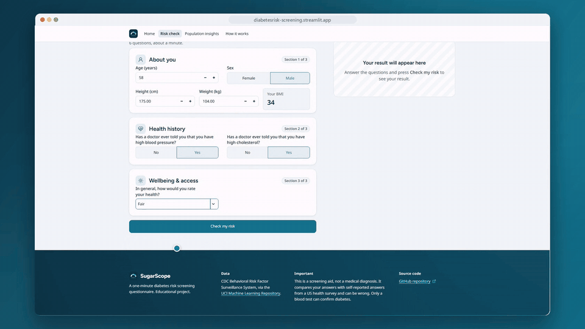

<p></p>

# SugarScope: diabetes risk screening

SugarScope is a web tool that estimates a person's chance of having diagnosed diabetes from simple health and lifestyle questions, so they know whether to ask a doctor for a blood sugar test.

**Live app:** https://<your-app>.streamlit.app <!-- TODO: replace with the deployed link -->





> **Not a diagnosis.** This is a screening aid trained on self-reported US survey answers. Only a blood test can confirm diabetes.

## Problem and metric

Millions of adults with diabetes don't know it. A short questionnaire can flag people who should get tested. Missing someone who is at risk costs more than an extra test, so the main metric is **recall** on the positive class (diagnosed diabetes), checked together with precision, F1, ROC-AUC, PR-AUC and the Brier score (are the percentages trustworthy?).

## Dataset

[CDC Diabetes Health Indicators](https://archive.ics.uci.edu/dataset/891) (UCI ML Repository, id 891): about 253,000 responses to the CDC's Behavioral Risk Factor Surveillance System (BRFSS) telephone survey, with 21 features. Target `Diabetes_binary`: 0 = no diabetes, 1 = diagnosed diabetes (prediabetes is coded 0). Credit: Centers for Disease Control and Prevention; UCI Machine Learning Repository.

## Approach

1. Exploratory analysis and cleaning in `notebook.ipynb`.
2. Stratified train/test split; models compared against a baseline.
3. Two models:
   - **Full check:** all 21 features.
   - **Quick check:** a handful of the most informative features, for a one-minute questionnaire.
4. Decision threshold and Low / Medium / High risk bands chosen on out-of-fold predictions on the training set, to favour recall.
5. A linear explainer shows which answers push a person's score up ("What raised your score"). These are associations, not causes.
6. A what-if simulator re-scores the same model with changed answers (weight, activity, treated blood pressure or cholesterol, and more).
7. Multi-year validation: trained on earlier BRFSS survey years and tested on a later year it never saw, with prevalence trends and a state map of actual vs predicted rates.
8. Respondents are clustered into population profiles (shown with a two-component PCA view), and a screening cost planner turns the threshold trade-off into cases caught, missed, false alarms and cost per 1,000 people.
9. Streamlit multipage app (`app.py`): Home, Risk check, Population insights and How it works. It turns friendly inputs (height + weight, age in years, worded answers) into the survey encodings.

## Results

Test-set results (held-out 20%, from `reports/results.csv`). Models at 0.5 are shown for comparison; the app uses the calibrated models at the screening cut-off.

| Model | Recall | Precision | F1 | ROC-AUC | PR-AUC | Brier |
|---|---|---|---|---|---|---|
| Baseline (always predicts the majority class) | 0.000 | 0.000 | 0.000 | 0.500 | 0.153 | 0.130 |
| Logistic regression (tuned, @0.5) | 0.154 | 0.539 | 0.239 | 0.810 | 0.414 | 0.107 |
| Random forest (tuned, @0.5) | 0.105 | 0.632 | 0.181 | 0.817 | 0.444 | 0.105 |
| Hist gradient boosting (tuned, @0.5) | 0.154 | 0.606 | 0.245 | 0.818 | 0.445 | 0.105 |
| **Full check**: HGB calibrated, screening cut-off | 0.799 | 0.314 | 0.451 | 0.819 | 0.444 | 0.105 |
| **Quick check** (6 questions): HGB calibrated, screening cut-off | 0.812 | 0.302 | 0.440 | 0.812 | 0.433 | 0.106 |

Multi-year validation (from `models/multiyear.json`): 1,210,322 BRFSS responses across 2015, 2017, 2019, 2021, 2025. Each model is tested on a later year it never saw.

| Trained on | Test year | n | ROC-AUC | Recall |
|---|---|---|---|---|
| BRFSS 2015 (saved model) | 2017 | 275,854 | 0.831 | 0.789 |
| BRFSS 2015 (saved model) | 2019 | 243,317 | 0.824 | 0.781 |
| BRFSS 2015 (saved model) | 2021 | 236,378 | 0.819 | 0.760 |
| BRFSS 2015 (saved model) | 2025 | 201,093 | 0.803 | 0.761 |
| 2015-2019 (retrained, odd years) | 2021 | 236,378 | 0.818 | 0.790 |
| 2015-2019 (retrained, odd years) | 2025 | 201,093 | 0.804 | 0.795 |

Accuracy drifts down in later years (ROC-AUC 0.831 in 2017 to 0.803 in 2025). Retraining on 2015–2019 does not fix it: ROC-AUC stays the same, and recall is only slightly higher.

## Run locally

Requires Python 3.12.

```bash
python -m venv .venv
.venv/Scripts/activate        # macOS/Linux: source .venv/bin/activate
pip install -r requirements.txt
streamlit run app.py
```

The app reads models from `models/`. Set `MODELS_DIR` to load them from somewhere else.

## Deploy on Streamlit Community Cloud

1. Push this repository to GitHub (with `models/` committed).
2. On [share.streamlit.io](https://share.streamlit.io), click **Create app** and pick the repo, branch `main`, main file `app.py`.
3. Under **Advanced settings**, choose Python **3.12**.
4. Deploy, then put the `*.streamlit.app` link at the top of this README.

## Project structure

```
app.py                  Streamlit app (multipage entry point)
assets/                 Logo, logo mark and favicon
models/                 Trained models + meta.json (thresholds, explainer, metrics);
                        optional segments.joblib/json, threshold_curve.json, multiyear.json and
                        state_prevalence.csv power Population insights (each section hides if its file is missing)
notebook.ipynb          Analysis, training and evaluation
reports/                Figures and results tables
data/                   Raw data (not committed)
requirements.txt        Pinned dependencies
.streamlit/config.toml  App theme
```

## Limitations

- **Not a medical diagnosis.** It estimates how similar your answers are to people who reported a diabetes diagnosis.
- Answers in the survey are self-reported, so the labels and features can be wrong (people may not know they have diabetes).
- Trained on BRFSS 2015 and validated on 956,642 responses from 2017–2025; accuracy drops slightly in later years, and results may not hold outside the US.
- Factors and what-if results are statistical associations. Changing one answer does not mean your actual risk changes by that amount.
- Population profiles describe groups, not individuals. Test costs in the planner are example assumptions.
- Type 1 and type 2 diabetes are combined into one label.
- The survey target does not include prediabetes, so a Low result does not rule out prediabetes. If you are worried, talk to a doctor about a blood sugar test.
